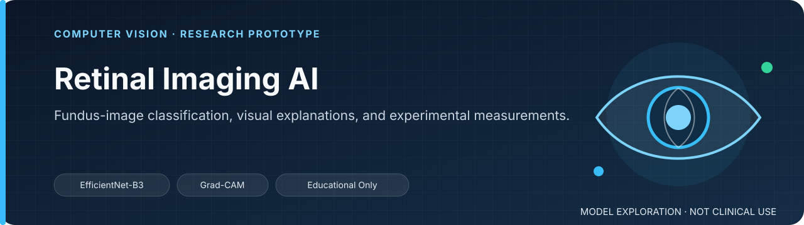
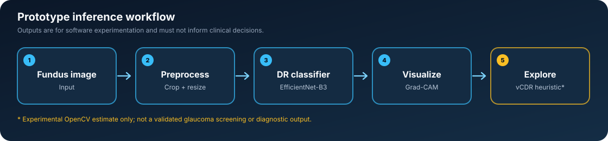

<div align="center">
  
  <h1>👁️ Diabetic Retinopathy & Glaucoma Detection AI</h1>
  <p><i>An academic computer-vision prototype for fundus-image analysis, with a Diabetic Retinopathy classifier, Grad-CAM visualizations, and heuristic optic-disc measurements</i></p>
  
  <p>
    
    
    
    
    
  </p>
</div>

<br>

This repository contains an **academic prototype** for analyzing retinal fundus images. It combines a five-class Diabetic Retinopathy (DR) image classifier, Grad-CAM visualizations, and an OpenCV-based heuristic estimate of the vertical Cup-to-Disc Ratio (vCDR) as an exploratory glaucoma-risk signal. It is intended for software demonstration and experimentation—not clinical diagnosis, triage, or treatment decisions.

---

## 🧭 Prototype workflow

<p align="center"></p>

---

## ✨ Key Features

*   🧠 **DR Classification Prototype:** Uses an EfficientNet-B3 architecture with five DR severity classes. The repository README previously reported **QWK 0.88, accuracy 77%, and sensitivity 67%** on the APTOS dataset; these are project-reported results and should be interpreted only with the matching evaluation protocol, class-wise metrics, and checkpoint. They are not evidence of clinical validation or generalization to other cameras/populations.
*   🔍 **Visual Explanations:** Generates Grad-CAM overlays for model inspection. A heatmap indicates image regions influencing the model; it does not prove that a lesion is present or provide a clinically validated explanation.
*   👁️ **Experimental Optic-Disc Heuristic:** Includes an OpenCV-based vCDR estimate using channel/contour processing. This is a heuristic demonstration, not a validated glaucoma screening test; image quality and segmentation errors can materially affect the estimate.
*   🐳 **Dockerized Demo:** Includes a Dockerfile and FastAPI web interface for local demonstration. Containerization does not make the model clinically validated or production-certified.

## 🔬 Dataset

This project was trained and evaluated on the **APTOS 2019 Blindness Detection Dataset**.
🔗 **[Dataset Link (Kaggle)](https://www.kaggle.com/datasets/mariaherrerot/aptos2019)**

---

## 🔬 Medical Preprocessing Pipeline

The current inference path applies image normalization and a circular crop (when available) before resizing to 224×224. The repository also documents the following preprocessing approach:
1.  **Dark Border Cropping:** Automatically detects and removes uninformative black borders from the raw fundus photography.
2.  **Ben Graham's Method:** Applies a weighted Gaussian Blur overlay to normalize lighting conditions and vastly improve the visibility of blood vessels and retinal lesions.

---

## 🛠️ Tech Stack

*   **Deep Learning:** PyTorch, Torchvision, PyTorch Grad-CAM
*   **Computer Vision:** OpenCV, Albumentations, PIL
*   **Backend & API:** FastAPI, Uvicorn, Pydantic
*   **Frontend:** Vanilla JavaScript, HTML5, CSS3
*   **Deployment:** Docker

---

## 🚀 Quick Start (Docker)

The repository includes a Docker-based local demo. Run it for software evaluation only; do not use its outputs for clinical decisions.

**1. Clone the repository:**
```bash
git clone https://github.com/EslamTagElsir/diabetic-retinopathy-glaucoma-detection.git
cd diabetic-retinopathy-glaucoma-detection
```

**2. Build the Docker Image:**
```bash
docker build -t diabetic-retinopathy-api .
```

**3. Run the Container:**
```bash
docker run -d -p 8000:8000 --name dr-api diabetic-retinopathy-api
```

The web application and API will now be live at: **[http://localhost:8000](http://localhost:8000)**

---

## ⚠️ Model and validation limitations

- The API looks for `models/best_model.pth`. If the checkpoint is absent, the inference code constructs an ImageNet-pretrained EfficientNet-B3 with a newly initialized five-class classification head. That fallback is **not a trained DR classifier** and its predictions must not be interpreted as meaningful DR results.
- The `/health` endpoint reports the inference engine as loaded, but that alone does not verify that a trained project checkpoint was loaded. Confirm the checkpoint and its provenance before any experiment.
- The reported APTOS metrics are not independent clinical validation. No prospective clinical study, external multi-site validation, regulatory clearance, or demonstrated patient-outcome benefit is claimed.
- Grad-CAM is a model-visualization aid, not a lesion detector or proof of causal reasoning. The vCDR routine is heuristic and must not be used to diagnose or rule out glaucoma.
- Outputs may be wrong or misleading. A qualified ophthalmologist must make all clinical assessments.

## 📁 Project Structure

```text
diabetic_retinopathy_project/
├── app/                  # FastAPI Application & Frontend
│   ├── static/           # JS, CSS, and Demo Images
│   ├── templates/        # HTML Views
│   └── main.py           # FastAPI Router & Server
├── src/                  # Core Machine Learning & CV Logic
│   ├── classifier_model.py # EfficientNet-B3 Architecture
│   ├── explain.py        # Grad-CAM implementation
│   ├── inference.py      # Production Inference Engine
│   └── cdr_calculator.py # OpenCV Glaucoma Heuristics
├── models/               # Trained Weights (best_model.pth)
├── scripts/              # Training & Data Prep Utilities
├── Dockerfile            # Lightweight Production Docker Build
├── .dockerignore         # Docker Context Filters
└── requirements.txt      # PyTorch CPU & Backend Dependencies
```

---

## 🧪 Intended use and disclaimer

This repository is an educational/research software prototype. It is **not a medical device** and is not intended to diagnose, screen, monitor, or recommend treatment for any person. Do not upload identifiable patient data to an unapproved environment. Any research use requires appropriate data governance, ethics approval where applicable, and independent validation.

---

## 🎓 Team & Acknowledgements

This system was developed as a graduation project under the honorable supervision of **Dr. Mohamed Elhadad**.

**Development Team:**
*   **Eslam Tag Elser**
*   **Mohamed Hassan Ahmed**
*   **Osama Mohamed Kamel**
*   **Ahmed Zain Elabiden**
*   **Ahmed Shehta Zoghli**

> *"Dedicated to improving accessible healthcare technology through open-source artificial intelligence."*
